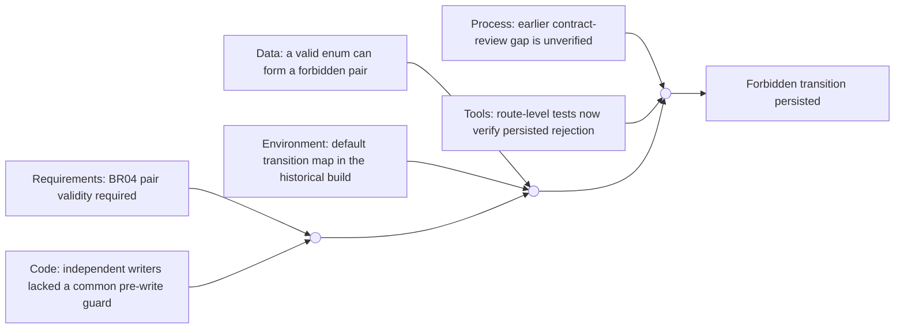
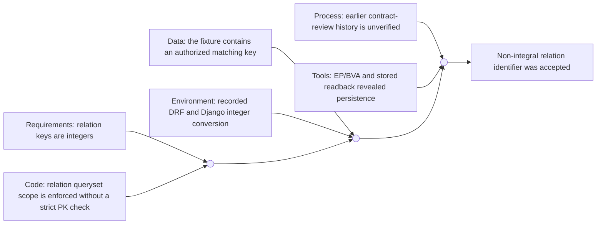

# Root cause analysis

Analysis date 27 November 2026. The team should assign individual owners and dates for open actions. The two S2 defects were selected for persistent effects on Ticket Management. Process hypotheses identify questions for team review.

## SQE-01 · Forbidden ticket transitions persisted

On the historical candidate, 30 forbidden transition cases failed across staff form, ticket PATCH and follow-up POST. The unchanged suite recorded 47 passes and 30 failures on baseline PR #1, then 77 passes on fix PR #2. [Defect and retest chain](../ticket-transition-defects.md#sqe-01-forbidden-transitions-persist-on-three-staff-write-paths)

| Why | Source-supported explanation |
| --- | --- |
| 1. Why did the stored state become forbidden? | Valid enum values reached persistence even when the source/target pair was unauthorized by the configured transition table. The historical requirements compare stored status and related history before and after the request. |
| 2. Why did staff form and follow-up POST write it? | Both take the shared update path. The status helper on that revision applied the numeric value without consulting the configured transition map. [Historical helper](../../../src/helpdesk/update_ticket.py) |
| 3. Why did ticket PATCH show the same defect? | Its serializer persisted through a separate path. Choice validation checked the value against the enum and did not validate the pair. [Historical serializer](../../../src/helpdesk/serializers.py) |
| 4. Why was the behavior inconsistent across entry points? | The public view implemented its own pair check. That check was local to the caller, leaving the shared helper and serializer without the same pre-write policy. [Historical public view](../../../src/helpdesk/views/public.py) |
| 5. Why could two independent write paths repeat the omission? | The configured transition requirement had no shared mandatory enforcement point across those paths. The fix moved the check into a common validator and called it before writing in both paths. [Fix PR](https://github.com/Abdul-Rafay-Jamil/django-helpdesk/pull/2) |

- **Corrective action.** Verify the existing shared pre-write validator and error handling on the eventual release candidate. Owner role is the Ticket Management maintainer. Corrective behavior is already verified on PR #2. Release verification remains open.
- **Preventive action.** Keep the required 77-case cross-route matrix and review new write entry points for common validator use. The effectiveness check is that every forbidden pair leaves status, resolution and history unchanged while allowed pairs still pass.

## API-03 · Non-integral relationship IDs reached persistence

The fixed candidate recorded eleven failed cases across ticket POST, PATCH and PUT and follow-up POST. Requests expected to fail validation returned 200 or 201 with stored effects against an existing synthetic record. The evidence demonstrates acceptance within the tested authorized scope. [Generated case assertions and raw evidence](../api-2026-11-27/README.md#confirmed-defects)

| Why | Source-supported explanation |
| --- | --- |
| 1. Why did the request persist an unintended relation? | The relation field resolved the supplied numeric value to an existing object. Saved readback shows the accepted writes rather than only a response-code difference. |
| 2. Why could the lookup resolve a non-integral value? | Installed DRF's `PrimaryKeyRelatedField.to_internal_value` calls `queryset.get(pk=data)` when no custom PK validator is set (`rest_framework/relations.py:238–259`). Installed Django's integer lookup preparation calls `int(value)` (`django/db/models/fields/__init__.py:2202–2212`). These source paths explain the observed coercion. |
| 3. Why did the serializer delegate the value to that default lookup? | On candidate `bec9c208`, TicketSerializer and FollowUpSerializer expose model relation fields without an explicit strict PK validator. The relation lookup result enters validated data. |
| 4. Why did the existing scope guard permit it? | `restrict_relation` narrows the lookup queryset. It controls which records are eligible and leaves the relation field's input-type handling in place. |
| 5. Why did the integer API contract fail at that boundary? | The reviewed application boundary delegates relation identity conversion to framework defaults. The documented scalar constraint has no dedicated check before the lookup. Any explanation about the team's earlier review or test design is unverified. |

Candidate source was inspected locally at `bec9c208546c127e0a36c344779113e9b4c8b601` in `src/helpdesk/serializers.py:107,275` and `src/helpdesk/views/api.py:28,131,159`. The dependency versions are in the saved [Python inventory](../security-2026-11-27/pip-audit.json). This RCA traces the observed fixture outcomes and the framework code; it does not infer a queue-authorization bypass.

- **Corrective action.** Validate integer relationship identifiers before relation lookup, preserving the authorization querysets and valid request forms. Owner role is the API maintainer. Effectiveness requires the eleven saved failing cases to reject without writes, with legitimate relation changes still working.
- **Preventive action.** Include strict scalar acceptance and persisted rejection in the generated contract suite for writable relationship fields. Verify the same behavior across ticket create, PATCH, PUT and follow-up create, and retain the queue isolation checks.
